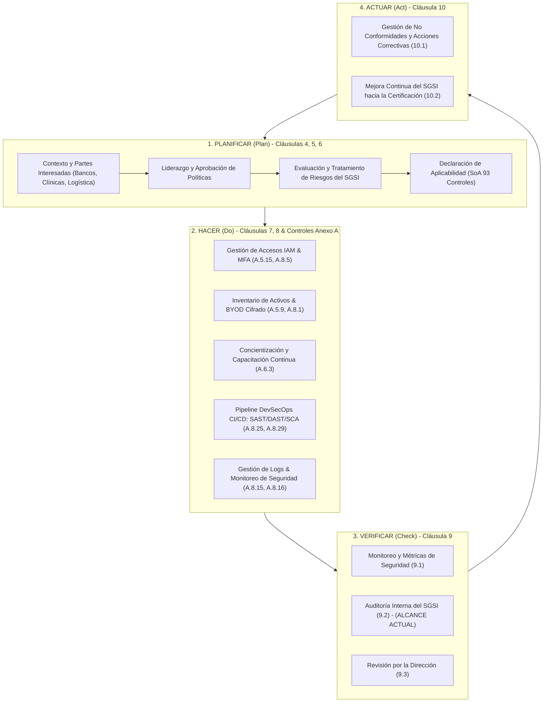
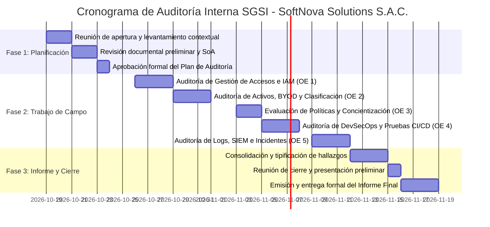

# PLAN DE AUDITORÍA DE TECNOLOGÍAS DE LA INFORMACIÓN

## CARÁTULA DE LA UNIVERSIDAD
**Universidad Privada de Tacna**  
Facultad de Ingeniería  
Escuela Profesional de Ingeniería de Sistemas  
Curso: Auditoría de Sistemas  

---

## CARÁTULA DEL PLAN DE AUDITORÍA

### AUDITORÍA INTERNA DE SEGURIDAD DE LA INFORMACIÓN AL SISTEMA DE GESTIÓN DE SEGURIDAD DE LA INFORMACIÓN (SGSI) DE SOFTNOVA SOLUTIONS S.A.C.

### LIMA / TACNA, PERÚ  
(Lima, Lima, San Isidro / Tacna, Tacna, Tacna)

### “Auditoría Interna de Seguridad de la Información basada en la Norma Técnica Peruana / Internacional ISO/IEC 27001:2022 a los Procesos de Desarrollo de Software, Gestión Cloud/DevOps y Protección de Activos de Información de SoftNova Solutions S.A.C.”

### TACNA, 14 DE OCTUBRE DE 2026

### “DECENIO DE LA IGUALDAD DE OPORTUNIDADES PARA MUJERES Y HOMBRES”
### “AÑO DEL BICENTENARIO, DE LA CONSOLIDACIÓN DE NUESTRA INDEPENDENCIA, Y DE LA CONMEMORACIÓN DE LAS HEROICAS BATALLAS DE JUNÍN Y AYACUCHO”

---

## ÍNDICE

| DENOMINACIÓN                                                        | N° Pág. |
|---------------------------------------------------------------------|---------|
| I. ORIGEN                                                           |    3    |
| II. INFORMACIÓN DE LA ENTIDAD O DEPENDENCIA                         |    4    |
| III. DENOMINACIÓN DE LA MATERIA DE CONTROL                          |    5    |
| IV. ALCANCE                                                         |    6    |
| V. OBJETIVOS                                                        |    7    |
| &nbsp;&nbsp;&nbsp;&nbsp;V.1 Objetivo General                        |    7    |
| &nbsp;&nbsp;&nbsp;&nbsp;V.2 Objetivos Específicos                   |    7    |
| VI. PROCEDIMIENTOS DE AUDITORÍA                                     |    8    |
| VII. PLAZO DE LA AUDITORÍA Y CRONOGRAMA                             |   11    |
| VIII. CRITERIOS DE AUDITORÍA                                       |   12    |
| IX. INFORMACIÓN ADMINISTRATIVA                                     |   13    |
| &nbsp;&nbsp;&nbsp;&nbsp;IX.1 Comisión Auditora                      |   13    |
| &nbsp;&nbsp;&nbsp;&nbsp;IX.2 Costos Directos Estimados             |   14    |
| X. DOCUMENTO A EMITIR                                              |   15    |
| ANEXOS                                                              |   17    |
| &nbsp;&nbsp;&nbsp;&nbsp;Anexo 1: Matriz de Riesgos de Seguridad de la Información | 17 |
| &nbsp;&nbsp;&nbsp;&nbsp;Anexo 2: Mapeo de Procesos del SGSI (Ciclo PHVA y Flujos Clave) | 19 |
| &nbsp;&nbsp;&nbsp;&nbsp;Anexo 3: Lista de Normativa y Estándares Aplicables | 21 |
| &nbsp;&nbsp;&nbsp;&nbsp;Anexo 4: Instrumentos de Recolección de Evidencia (Checklists y Guías) | 23 |
| &nbsp;&nbsp;&nbsp;&nbsp;Anexo 5: Matriz de Trazabilidad (Objetivos, Controles, Procedimientos y Evidencias) | 26 |
| &nbsp;&nbsp;&nbsp;&nbsp;Anexo 6: Cronograma Detallado por Actividad y Responsable | 28 |

---

## I. ORIGEN

La presente Auditoría de Tecnologías de la Información y Seguridad de la Información se origina formalmente en cumplimiento del **Programa Anual de Auditorías Internas 2026** de **SoftNova Solutions S.A.C.**, conforme lo estipula la **Cláusula 9.2 (Auditoría Interna)** del estándar internacional **ISO/IEC 27001:2022**.

La necesidad de esta intervención de control deviene de los siguientes factores estratégicos y operativos:
1. **Compromiso Contractual y Regulatorio:** SoftNova Solutions gestiona, desarrolla e integra soluciones tecnológicas para clientes corporativos de alta sensibilidad en los sectores de **Banca y Finanzas, Salud y Logística**, los cuales exigen contractualmente estrictos acuerdos de nivel de servicio (SLA), acuerdos de confidencialidad (NDA) y estándares verificables de seguridad digital.
2. **Preparación hacia la Certificación ISO/IEC 27001:** La Alta Dirección ha fijado como objetivo corporativo la obtención de la certificación formal del Sistema de Gestión de Seguridad de la Información (SGSI). Para ello, resulta indispensable evaluar la madurez, pertinencia y eficacia de los controles implementados previo a la auditoría externa de certificación (Fase 1 y Fase 2).
3. **Alertas e Indicios Detectados en la Fase Preparatoria:** A través de revisiones preliminares y levantamientos de información pasivos, se identificaron brechas críticas que amenazan la confidencialidad, integridad y disponibilidad de los activos, tales como:
   - Uso de cuentas compartidas y carencia de autenticación multifactor (MFA) en entornos de desarrollo y sistemas críticos.
   - Inventario de activos incompleto, empleo de dispositivos personales (BYOD) sin cifrado ni autorización, y falta de registro de datos sensibles.
   - Políticas de seguridad suscritas por la dirección pero carentes de difusión y concientización hacia el personal operativo.
   - Canalizaciones de integración y entrega continua (DevOps) sin controles de seguridad automatizados (DevSecOps) y sin análisis de vulnerabilidades previo al pase a producción.
   - Carencia de un sistema centralizado de correlación de eventos de seguridad (SIEM/logs) y ausencia de ejercicios de simulación de respuesta a incidentes.

Por tanto, este plan establece las pautas metodológicas, técnicas y operativas bajo las cuales la Comisión Auditora llevará a cabo la evaluación integral del SGSI.

---

## II. INFORMACIÓN DE LA ENTIDAD O DEPENDENCIA

- **Razón Social**: SoftNova Solutions S.A.C.
- **RUC**: 20608945123
- **Sector**: Tecnologías de la Información - Desarrollo de Software y Consultoría Cloud
- **Nivel de Gobierno**: No Aplica (Sector Privado - Empresa Peruana de Base Tecnológica)
- **Sede Principal**: Av. Canaval y Moreyra N° 452, Piso 8, San Isidro, Lima, Perú
- **Modalidad Operativa**: Híbrida (Presencial en sede central y teletrabajo distribuido a nivel nacional)
- **Tamaño de la Organización**: 120 colaboradores (Áreas de Ingeniería de Software, DevOps, Infraestructura Cloud, QA, Comercial y Dirección)
- **Líneas de Servicio Principales**:
  - Desarrollo de software a medida (aplicaciones Web y Móviles nativas/híbridas).
  - Implementación y orquestación de arquitecturas DevOps / Cloud Computing (AWS / Azure).
  - Integración segura de APIs de pago, interoperabilidad clínica y trazabilidad logística.
  - Mesa de ayuda y soporte técnico especializado 24/7.
- **Cartera de Clientes**: Entidades bancarias supervisadas por SBS, clínicas privadas con manejo de historias clínicas electrónicas y operadores logísticos internacionales de comercio exterior.

---

## III. DENOMINACIÓN DE LA MATERIA DE CONTROL

> **“Auditoría Interna de Cumplimiento y Eficacia del Sistema de Gestión de Seguridad de la Información (SGSI) bajo la Norma ISO/IEC 27001:2022 aplicada a los Entornos de Desarrollo de Software, Canales DevOps, Gestión de Accesos, Dispositivos de Usuario Final y Capacidad de Respuesta ante Incidentes en SoftNova Solutions S.A.C.”**

La materia de control abarca la verificación del grado de conformidad de los requisitos de gestión (Cláusulas 4 a 10) y la idoneidad técnica de los controles operacionales del **Anexo A** de ISO/IEC 27001:2022, focalizándose en los dominios Organizacional (5), Personas (6) y Tecnológico (8).

---

## IV. ALCANCE

La auditoría comprenderá la evaluación de los procesos, sistemas, infraestructura tecnológica, personal y documentación que sustentan el SGSI de SoftNova Solutions S.A.C., abarcando el periodo operativo comprendido entre el **01 de enero de 2026** y el **14 de octubre de 2026**, extendiéndose la fase de pruebas técnicas y de campo hasta el **11 de noviembre de 2026**.

### Componentes Específicos dentro del Alcance:
1. **Entorno de Gestión del SGSI (Gobierno y Personas):**
   - Políticas, normas y procedimientos de seguridad aprobados por la Alta Dirección.
   - Mecanismos de comunicación, programas de inducción, capacitación continua y concientización a los 120 colaboradores.
   - Declaración de Aplicabilidad (Statement of Applicability - SoA) vigente.
2. **Gestión de Accesos e Identidades (IAM):**
   - Directorios de usuarios (Google Workspace / Microsoft Entra ID), servidores VPN corporativos y consolas de gestión en la nube (AWS Management Console / Azure Portal).
   - Repositorios de código fuente (GitHub Enterprise / GitLab) y gestores de secretos (HashiCorp Vault / AWS Secrets Manager).
3. **Activos de Información y Endpoints:**
   - Inventario formal de activos de hardware, software y datos sensibles (propios y de clientes).
   - Políticas y controles aplicados sobre equipos portátiles corporativos y dispositivos personales bajo modalidad BYOD (*Bring Your Own Device*).
   - Verificación de mecanismos de cifrado de disco (BitLocker / FileVault) y soluciones de protección de endpoints (EDR/Antivirus).
4. **Ciclo de Vida de Desarrollo de Software (DevSecOps):**
   - Procesos de diseño, codificación, revisión por pares y despliegue continuo (CI/CD pipelines en GitHub Actions / Jenkins).
   - Integración de herramientas de análisis estático (SAST), análisis dinámico (DAST) y análisis de composición de software (SCA).
   - Separación lógica y de privilegios entre entornos de Desarrollo (*Development*), Pruebas (*Testing/QA*), Preproducción (*Staging*) y Producción (*Production*).
5. **Monitoreo, Trazabilidad y Gestión de Incidentes:**
   - Mecanismos de generación, almacenamiento y retención de registros de auditoría (*logs*) en servidores, bases de datos y balanceadores.
   - Arquitectura de centralización de eventos de seguridad (SIEM / Syslog).
   - Procedimiento documentado de respuesta a incidentes de seguridad de la información y registros de simulacros ejecutados.

---

## V. OBJETIVOS

### V.1 Objetivo General:
Evaluar el grado de conformidad, madurez y eficacia operativa del **Sistema de Gestión de Seguridad de la Información (SGSI)** de **SoftNova Solutions S.A.C.** respecto a los requisitos y controles de la norma **ISO/IEC 27001:2022**, identificando vulnerabilidades, no conformidades y brechas de control en los procesos de desarrollo de software, gestión de accesos, custodia de activos y respuesta a incidentes, con la finalidad de formular recomendaciones orientadas a la certificación internacional y la salvaguarda de los datos sensibles propios y de clientes.

### V.2 Objetivos Específicos:
1. **Gestión de Accesos y Autenticación:** Evaluar las directivas y controles técnicos de autenticación, asignación de privilegios y gestión de identidades, verificando la supresión de credenciales genéricas o compartidas y la obligatoriedad del Factor de Autenticación Múltiple (MFA) en sistemas e infraestructuras críticas (Controles ISO 27001:2022 A.5.15, A.5.16, A.5.17, A.8.5).
2. **Inventario, Clasificación y Seguridad en Dispositivos (BYOD):** Verificar la exhaustividad del inventario de activos de información, el registro y clasificación formal de datos confidenciales (banca, salud, logística), y la aplicación de salvaguardas técnicas (cifrado y control de acceso) en equipos de cómputo personales y corporativos (Controles ISO 27001:2022 A.5.9, A.5.10, A.5.12, A.8.1, A.8.7).
3. **Cultura, Capacitación y Socialización de Políticas:** Comprobar el nivel de difusión, apropiación y sensibilización del personal en torno a las políticas de seguridad de la información aprobadas, evaluando la efectividad del programa de capacitación y concientización (Cláusulas 5.2, 7.2, 7.3 e ISO 27001:2022 Controles A.5.1, A.6.3).
4. **Seguridad en el Ciclo de Vida de Desarrollo (DevSecOps):** Auditar los procesos de desarrollo, compilación y despliegue de software, examinando la incorporación de pruebas automatizadas de seguridad (SAST, DAST, escaneo de dependencias) y la gestión de vulnerabilidades antes del paso a producción (Controles ISO 27001:2022 A.8.25, A.8.26, A.8.28, A.8.29).
5. **Monitoreo, Auditoría de Eventos y Gestión de Incidentes:** Inspeccionar la existencia, configuración y protección de registros de eventos de seguridad (logs), la viabilidad de correlación centralizada (SIEM) y la operatividad de los protocolos de detección, contención y recuperación ante incidentes de ciberseguridad (Controles ISO 27001:2022 A.8.15, A.8.16, A.5.24, A.5.25, A.5.26, A.5.28).

---

## VI. PROCEDIMIENTOS DE AUDITORÍA

Los procedimientos a ejecutar por la Comisión Auditora se estructuran a continuación:

**Cuadro n.º 1 – Procedimientos de Auditoría**

| Obj. Esp. | Código | Procedimientos Detallados de Auditoría | Técnicas / Herramientas | Responsable |
|:---------:|:------:|:---------------------------------------|:------------------------|:-----------:|
| **OE 1** | **P-1.1** | Revisión y análisis de la directiva de control de accesos lógicos y la matriz de roles y privilegios (RBAC) aplicada en repositorios GitHub, consolas AWS/Azure y bases de datos. | Inspección documental y muestreo en consolas IAM | **AC** |
| | **P-1.2** | Inspección técnica del directorio centralizado y verificación de cuentas de servicio, eliminando o restringiendo cuentas compartidas en servidores de desarrollo y pruebas. | Consulta LDAP/Entra ID, scripts PowerShell / Bash | **AC** |
| | **P-1.3** | Verificación de la obligatoriedad y cumplimiento efectivo de la Autenticación Multifactor (MFA) con tokens TOTP/FIDO2 en accesos VPN, consolas cloud y paneles de administración. | Auditoría de políticas de acceso condicional | **GH** |
| **OE 2** | **P-2.1** | Cotejo y verificación del Inventario de Activos de Información frente a los recursos reales (físicos, lógicos y repositorios de datos), verificando campos de propietario y criticidad. | Comparación contra reportes de red y CMDB | **CC** |
| | **P-2.2** | Evaluación del cumplimiento de la Política de Teletrabajo y Dispositivos Personales (BYOD), auditando el uso de cifrado integral de disco (BitLocker/FileVault) y software de protección en una muestra del 25% de colaboradores. | Muestreo aleatorio, inspección técnica remota | **GH** |
| | **P-2.3** | Verificación del etiquetado y clasificación de la información conforme a la Ley N° 29733 (Datos Personales y Sensibles de clientes de salud y banca), evaluando restricciones de almacenamiento. | Revisión de esquemas de BD y políticas de DLP | **CC** |
| **OE 3** | **P-3.1** | Revisión de las evidencias de aprobación, publicación y difusión formal de las políticas de seguridad de la información hacia todos los niveles organizacionales de SoftNova. | Revisión de actas, intranet y acuses de recibo | **CC** |
| | **P-3.2** | Aplicación de encuestas estructuradas y entrevistas a una muestra representativa del personal operativo (desarrolladores, DevOps, soporte) para medir el nivel de comprensión de las directivas. | Formulario digital de evaluación / Entrevistas | **AC** |
| | **P-3.3** | Evaluación del Plan Anual de Capacitación y Concientización en Seguridad de la Información, revisando temarios, asistencias, evaluaciones de eficacia y campañas anti-phishing. | Inspección de registros académicos de RR.HH. | **CC** |
| **OE 4** | **P-4.1** | Revisión de los pipelines de CI/CD (GitHub Actions / Jenkins) para verificar la integración obligatoria de compuertas de seguridad (*Quality Gates*) con herramientas SAST (SonarQube) y SCA (Trivy / OWASP Dependency-Check). | Auditoría de archivos YAML de configuración | **GH** |
| | **P-4.2** | Inspección de los procedimientos de pruebas dinámicas (DAST) y escaneo de vulnerabilidades previo al despliegue en entornos de Staging/Producción en aplicaciones web y APIs. | Revisión de reportes de escaneo OWASP ZAP / Burp | **GH** |
| | **P-4.3** | Verificación de la segregación de funciones e independencia de ambientes: revisión de restricciones para que desarrolladores no tengan permisos de inyección directa de código a producción. | Auditoría de permisos de ramas y accesos a Prod | **AC** |
| **OE 5** | **P-5.1** | Auditoría a la configuración de registros de auditoría (logs) en servidores web, contenedores Kubernetes, APIs y bases de datos, validando sincronización horaria mediante NTP. | Inspección de configuraciones syslog y auditd | **GH** |
| | **P-5.2** | Evaluación de la capacidad actual de retención, protección contra borrado y análisis centralizado de eventos de seguridad (identificando la brecha de ausencia de un SIEM formal). | Pruebas de integridad de logs y retención | **AC** |
| | **P-5.3** | Revisión del Procedimiento de Gestión y Respuesta a Incidentes de Seguridad de la Información, evaluando la realización de simulacros, actas de incidentes pasados y tiempos de respuesta. | Revisión de bitácoras de incidentes y protocolos | **CC** |

*(Nomenclatura de Responsables: **CC** = Cesar Nikolas Camac Melendez [Supervisor / Auditor Líder], **AC** = Andy Michael Calizaya Ladera [Jefe de Comisión / Auditor SGSI], **GH** = Gregory Brandon Huanca Merma [Auditor Especialista DevSecOps y Ciberseguridad]).*

---

## VII. PLAZO DE LA AUDITORÍA Y CRONOGRAMA

La auditoría se llevará a cabo durante un plazo total de **25 días hábiles** (5 semanas calendario), distribuidos de acuerdo al siguiente cronograma:

**Cronograma General por Fases**

| Etapa / Fase | Actividades Principales | Fecha de Inicio | Fecha de Finalización | Duración (Días Hábiles) |
|:------------|:------------------------|:---------------:|:---------------------:|:-----------------------:|
| **1. Planificación** | Levantamiento preliminar, reunión de apertura, análisis contextual, emisión y aprobación del Plan de Auditoría. | 19/10/2026 | 23/10/2026 | 5 días |
| **2. Ejecución (Trabajo de Campo)** | Aplicación de pruebas de auditoría, entrevistas, revisión de configuraciones, muestreo técnico y verificación de controles ISO 27001. | 26/10/2026 | 11/11/2026 | 13 días |
| **3. Elaboración del Informe** | Consolidación de hallazgos, formulación de No Conformidades y Recomendaciones, reunión de cierre y emisión del Informe Final. | 12/11/2026 | 20/11/2026 | 7 días |
| **Total General** | | **19/10/2026** | **20/11/2026** | **25 días útiles** |

---

## VIII. CRITERIOS DE AUDITORÍA

La presente auditoría evaluará la conformidad del SGSI y de la infraestructura tecnológica tomando como fundamento los siguientes cuerpos normativos y técnicos:

1. **Estándares Internacionales de Gestión y Seguridad:**
   - **ISO/IEC 27001:2022:** *Information security, cybersecurity and privacy protection — Information security management systems — Requirements* (Cláusulas 4 a 10 y Controles del Anexo A).
   - **ISO/IEC 27002:2022:** *Information security, cybersecurity and privacy protection — Information security controls* (Guía de directrices e implementación de controles).
   - **ISO 19011:2018:** *Directrices para la auditoría de los sistemas de gestión*.
   - **OWASP Application Security Verification Standard (ASVS) v4.0.3:** Marco de verificación para desarrollo seguro de software.
2. **Marco Legal y Regulatorio Peruano:**
   - **Ley N° 29733 - Ley de Protección de Datos Personales:** Y su Reglamento aprobado mediante Decreto Supremo N° 003-2013-JUS, aplicable a la custodia de datos de clientes y colaboradores.
   - **Decreto de Urgencia N° 007-2020:** Que aprueba el Marco de Confianza Digital y dispone medidas para el fortalecimiento de la seguridad digital en el Perú.
   - **Resolución SBS N° 504-2021:** *Reglamento para la Gestión de la Seguridad de la Información y la Ciberseguridad* (referencial para los servicios brindados por SoftNova a clientes del sector financiero).
3. **Políticas y Documentación Interna de SoftNova Solutions S.A.C.:**
   - Política General de Seguridad de la Información (v1.2).
   - Declaración de Aplicabilidad (SoA - Statement of Applicability).
   - Manual del SGSI y Procedimiento de Gestión del Riesgo Tecnológico.
   - Directivas de Control de Acceso, Teletrabajo/BYOD y Política de Clasificación de la Información.

---

## IX. INFORMACIÓN ADMINISTRATIVA

### IX.1 Comisión Auditora

La Comisión Auditora designada está integrada por especialistas en auditoría de sistemas, gobierno de TI, ciberseguridad y entornos DevSecOps:

**Cuadro n.º 2 – Comisión Auditora**

| Cargo en la Comisión | Nombres y Apellidos | Calificación / Profesión | Planificación (días) | Ejecución (días) | Informe (días) | Total (días) |
|:---------------------|:--------------------|:-------------------------|:--------------------:|:----------------:|:--------------:|:------------:|
| **Supervisor de Auditoría** | Cesar Nikolas Camac Melendez | Ing. de Sistemas / Auditor Líder SGSI ISO 27001 | 5 | 13 | 7 | 25 |
| **Jefe de Comisión** | Andy Michael Calizaya Ladera | Ing. de Sistemas / Especialista en Gobernanza de TI y Riesgos | 5 | 13 | 7 | 25 |
| **Auditor Integrante 1** | Gregory Brandon Huanca Merma | Ing. de Sistemas / Especialista en DevSecOps y Ciberseguridad | 5 | 13 | 7 | 25 |

---

### IX.2 Costos Directos Estimados

El presupuesto proyectado para la ejecución de la auditoría interna se detalla a continuación:

**Cuadro n.º 3 – Costo de Horas-Hombre y Asignaciones Operativas**

| N° | Miembro / Rol | Nivel Profesional | Días Efectivos | Tarifa H/H (S/.) | Horas Totales (8h/d) | Costo H/H (S/.) | Herramientas / Licencias (S/.) | Costo Total (S/.) |
|:--:|:--------------|:------------------|:--------------:|:----------------:|:--------------------:|:---------------:|:------------------------------:|:-----------------:|
| 1 | Supervisor de Auditoría | Senior / Líder | 25 | S/. 120.00 | 200 h | S/. 24,000.00 | S/. 800.00 | S/. 24,800.00 |
| 2 | Jefe de Comisión | Senior / SGSI | 25 | S/. 100.00 | 200 h | S/. 20,000.00 | S/. 800.00 | S/. 20,800.00 |
| 3 | Auditor Especialista | Especialista DevSecOps | 25 | S/. 90.00 | 200 h | S/. 18,000.00 | S/. 1,200.00 | S/. 19,200.00 |
| | **Subtotales** | | | | **600 h** | **S/. 62,000.00** | **S/. 2,800.00** | **S/. 64,800.00** |
| | **Gastos Logísticos y Materiales** | | | | | | | S/. 1,800.00 |
| | **TOTAL GENERAL ESTIMADO (S/.)** | | | | | | | **S/. 66,600.00** |

*(Nota: En el marco del desarrollo de la asignatura universitaria de Auditoría de Sistemas, los costos son referenciales con fines de simulación profesional y académica).*

---

## X. DOCUMENTO A EMITIR

Como producto final de la intervención se emitirá el **“Informe de Auditoría Interna de Seguridad de la Información del SGSI - SoftNova Solutions S.A.C.”**, el cual observará la estructura normalizada de la norma ISO 19011 y las mejores prácticas de auditoría:

### Estructura del Informe Final:
1. **Resumen Ejecutivo:** Diagnóstico de la postura de seguridad, nivel de madurez alcanzado por el SGSI y resumen cuantitativo de hallazgos.
2. **Introducción y Antecedentes:** Justificación y marco legal de la auditoría.
3. **Objetivos, Alcance y Metodología:** Definición de los límites evaluados y técnicas de verificación aplicadas.
4. **Dictamen de Auditoría Interna:** Pronunciamiento formal sobre la conformidad del SGSI frente a ISO/IEC 27001:2022.
5. **Matriz Detallada de Hallazgos de Auditoría:**
   - **No Conformidades Mayores (NC+):** Incumplimientos totales o fallas sistémicas que comprometen gravemente los objetivos del SGSI (ej. ausencia de MFA en sistemas críticos, falta de cifrado en datos de clientes bancarios/clínicos).
   - **No Conformidades Menores (NC-):** Desviaciones parciales que no comprometen de inmediato la totalidad del control (ej. desactualización puntual en registros del inventario de activos).
   - **Oportunidades de Mejora (OM):** Recomendaciones preventivas para elevar la resiliencia operativa y la automatización de la seguridad.
6. **Plan de Acción y Recomendaciones:** Acciones correctivas sugeridas con matriz de priorización (Impacto vs. Complejidad), responsables y plazos máximos para levantar las observaciones antes de la auditoría de certificación.
7. **Conclusiones Generales:** Apreciación del equipo auditor sobre la viabilidad técnica para postular a la certificación ISO/IEC 27001:2022.

---

**Tacna**, **14 de octubre de 2026**

 

_____________________________________________  
**Cesar Nikolas Camac Melendez**  
Supervisor de Auditoría  
Auditor Líder SGSI (ISO/IEC 27001)  

 

_____________________________________________  
**Andy Michael Calizaya Ladera**  
Jefe de Comisión  
Especialista en Gobierno y Gestión de Riesgos de TI  

 

_____________________________________________  
**Gregory Brandon Huanca Merma**  
Auditor Integrante  
Especialista en DevSecOps y Ciberseguridad  

---

## ANEXOS

### Anexo 1: Matriz de Riesgos de Seguridad de la Información (SGSI)

A partir de la situación actual y las debilidades preliminares detectadas en SoftNova Solutions S.A.C., se ha elaborado la matriz de riesgos específica que orienta las pruebas de auditoría:

| ID | Riesgo Identificado | Causa Raíz Potencial | Impacto en el Negocio / Legal | Prob. (1-5) | Imp. (1-5) | Nivel de Riesgo | Controles ISO/IEC 27001:2022 a Evaluar |
|:--:|:--------------------|:---------------------|:------------------------------|:-----------:|:----------:|:---------------:|:---------------------------------------|
| **R-01** | **Acceso no autorizado y suplantación de identidad** en consolas cloud y servidores de desarrollo. | Existencia de cuentas compartidas y ausencia de Factor de Autenticación Múltiple (MFA) en sistemas críticos. | Pérdida de trazabilidad de cambios, fuga o manipulación de código fuente y credenciales de clientes. | 4 | 5 | **Crítico (20)** | **A.5.15** Control de acceso **A.5.16** Gestión de identidades **A.5.17** Info. de autenticación **A.8.5** Autenticación segura |
| **R-02** | **Fuga masiva de datos sensibles de clientes** (historias clínicas, transacciones bancarias, rutas de transporte) almacenados en endpoints. | Uso de equipos personales (BYOD) sin autorización, carencia de cifrado de almacenamiento y falta de registro formal de activos de datos. | Sanciones de la ANPD (hasta 100 UIT por Ley 29733), demandas contractuales de bancos y clínicas, pérdida irreversible de reputación. | 4 | 5 | **Crítico (20)** | **A.5.9** Inventario de activos **A.5.10** Uso aceptable **A.5.12** Clasificación de info. **A.8.1** Dispositivos de usuario **A.8.7** Protección contra malware |
| **R-03** | **Comportamientos inseguros e incidentes causados por factor humano** (phishing, fuga accidental de información). | Políticas aprobadas pero no difundidas al personal; inexistencia de capacitaciones y entrenamientos de seguridad al personal operativo. | Infección por malware/ransomware, compromiso de cuentas corporativas y no conformidad insalvable en auditoría de certificación. | 4 | 4 | **Alto (16)** | **Cláusula 5.2** Política **Cláusula 7.2** Competencia **Cláusula 7.3** Toma de conciencia **A.5.1** Políticas de seguridad **A.6.3** Toma de conciencia |
| **R-04** | **Inyección de código vulnerable o malicioso en software entregado a clientes** (APIs financieras, sistemas clínicos). | Procesos DevOps sin compuertas de seguridad automáticas (SAST/DAST) y ausencia de análisis de dependencias de terceros (SCA). | Vulneración de sistemas de clientes en producción, responsabilidad civil contractual y caída de servicios esenciales. | 4 | 5 | **Crítico (20)** | **A.8.25** Ciclo de vida seguro **A.8.26** Requisitos de aplicaciones **A.8.28** Codificación segura **A.8.29** Pruebas de seguridad |
| **R-05** | **Imposibilidad de detectar intrusiones y respuesta tardía o ineficaz ante ataques informáticos**. | Falta de un sistema centralizado de correlación de eventos (SIEM), logs dispersos y carencia de simulacros periódicos de incidentes. | Persistencia de atacantes no detectados (*dwell time* elevado), destrucción de evidencias forenses y prolongado tiempo de inoperatividad. | 4 | 4 | **Alto (16)** | **A.8.15** Registro de eventos **A.8.16** Actividades de monitoreo **A.5.24** Planif. resp. incidentes **A.5.28** Recolección de evidencia |

---

### Anexo 2: Mapeo de Procesos del SGSI (Ciclo PHVA y Flujos Operativos)

La auditoría evalúa el alineamiento de los procesos bajo el ciclo de mejora continua **Planificar - Hacer - Verificar - Actuar (PHVA)**:

#### Flujo Operativo Crítico Auditado: Integración DevSecOps y Protección de Datos
1. **Desarrollador (Estación autorizada con cifrado BitLocker/FileVault):** Realiza commit de código en rama de feature.
2. **Autenticación (GitHub Enterprise):** Requiere obligatoriamente MFA (FIDO2/TOTP). Prohibidas credenciales genéricas.
3. **Pipeline CI/CD (GitHub Actions):**
   - *Paso 1 (Linter & Build):* Verificación sintáctica.
   - *Paso 2 (SAST - SonarQube):* Escaneo estático de fallas OWASP Top 10 y debilidades CWE.
   - *Paso 3 (SCA - Trivy / Snyk):* Detección de vulnerabilidades en dependencias de terceros (CVE).
   - *Paso 4 (Secret Scanning):* Verificación de que no existan API keys ni credenciales en código.
   - *Quality Gate:* Si se detectan vulnerabilidades altas o críticas, el pipeline bloquea el merge.
4. **Despliegue a Staging / Producción:** Solo personal autorizado mediante segregación de funciones (DevOps Leads) puede aprobar el despliegue a producción, registrando evento inmutable en el sistema de logs.

---

### Anexo 3: Lista de Normativa y Estándares Aplicables

| N° | Norma / Estándar / Ley | Ámbito | Artículos / Cláusulas Aplicables | Aplicabilidad para SoftNova Solutions S.A.C. |
|:--:|:-----------------------|:------:|:--------------------------------|:---------------------------------------------|
| 1 | **ISO/IEC 27001:2022** | Internacional | Cláusulas 4 al 10; Controles del Anexo A (Temas Organizacional, Personas, Físico, Tecnológico). | Norma marco sobre la cual se audita el SGSI y sobre la que la empresa busca certificarse. |
| 2 | **ISO/IEC 27002:2022** | Internacional | Directrices de implementación de los 93 controles de seguridad. | Guía técnica para comprobar si la implementación de controles en SoftNova es adecuada y efectiva. |
| 3 | **Ley N° 29733 - Ley de Protección de Datos Personales (Perú)** | Nacional (Obligatorio) | Arts. 13 (Seguridad), 14 (Confidencialidad), 17 (Tratamiento de datos sensibles), 28 (Infracciones). | Obligatorio por el tratamiento de datos de salud (clínicas), datos de pago (bancos) y personal propio. |
| 4 | **D.S. N° 003-2013-JUS (Reglamento de la Ley N° 29733)** | Nacional (Obligatorio) | Arts. 39 al 42 (Medidas de seguridad técnicas, organizativas y legales para bancos de datos). | Exige medidas de seguridad específicas para bancos de datos de nivel alto (datos sensibles de salud y financieros). |
| 5 | **Resolución SBS N° 504-2021** | Nacional (Sector Financiero) | Capítulos II y III (Requisitos de ciberseguridad exigidos a proveedores de servicios cloud y TI). | Aplica a SoftNova en su condición de proveedor crítico de software e integraciones para entidades bancarias. |
| 6 | **OWASP ASVS v4.0.3** | Buenas Prácticas | V1 (Arquitectura), V2 (Autenticación), V5 (Validación), V14 (Configuración). | Criterio técnico para auditar la seguridad en el ciclo de vida de desarrollo de software (SDLC/DevSecOps). |
| 7 | **D.U. N° 007-2020** | Nacional (Perú) | Disposiciones de confianza y seguridad digital nacional. | Marco referencial para articulación ante incidentes de ciberseguridad en infraestructura crítica. |

---

### Anexo 4: Instrumentos de Recolección de Evidencia

#### 1. Lista de Chequeo de Auditoría (Checklist ISO/IEC 27001:2022)

| Control ISO 27001:2022 | Cuestionario de Verificación de Auditoría | Evidencia Solicitada | Método de Evaluación | C / NC / OM |
|:-----------------------|:------------------------------------------|:---------------------|:--------------------:|:-----------:|
| **A.5.1 Políticas de seguridad de la información** | ¿Existen políticas de seguridad aprobadas por la Alta Dirección y revisadas a intervalos planificados? | Documento de Política v1.2, acta de aprobación | Revisión documental | |
| **A.5.15 Control de acceso** | ¿El acceso a los sistemas y entornos se limita según la política de necesidad de saber y privilegios mínimos? | Matriz RBAC, configuración de IAM en AWS/Azure | Inspección técnica | |
| **A.5.16 Gestión de identidades** | ¿Cada colaborador tiene una cuenta única e individual? ¿Se han eliminado las cuentas genéricas en desarrollo? | Listado de usuarios en Git, consolas y VPN | Muestreo de cuentas | |
| **A.8.5 Autenticación segura** | ¿Se exige obligatoriamente MFA (2FA) para el acceso a consolas cloud, bases de datos y repositorios de código? | Captura de configuración de acceso condicional | Prueba técnica en vivo | |
| **A.5.9 Inventario de información y otros activos** | ¿Se mantiene un inventario exhaustivo y actualizado de todos los activos de hardware, software y datos sensibles? | Registro de inventario / CMDB actualizado | Cotejo contra red | |
| **A.8.1 Dispositivos de usuario final (BYOD)** | ¿Los equipos portátiles corporativos y BYOD cuentan con cifrado integral de disco y software de protección activo? | Verificación de BitLocker/FileVault en muestra | Inspección en 25% de equipos | |
| **A.5.12 Clasificación de la información** | ¿Se encuentran catalogados y clasificados los datos sensibles de clientes bancarios, clínicos y logísticos? | Registro de esquemas de datos y manual DLP | Revisión de bases de datos | |
| **A.6.3 Toma de conciencia y capacitación** | ¿El personal operativo ha recibido capacitaciones y evaluaciones de concientización en seguridad en los últimos 6 meses? | Registros de asistencia, notas de evaluación | Muestreo en RR.HH. | |
| **A.8.25 Ciclo de vida de desarrollo seguro** | ¿Se encuentran formalizadas y automatizadas las reglas de desarrollo seguro en los repositorios institucionales? | Manual de DevSecOps, reglas de ramas Git | Inspección de repositorios | |
| **A.8.29 Pruebas de seguridad en desarrollo** | ¿Se ejecutan análisis automáticos SAST, DAST y análisis de dependencias (SCA) antes de cada pase a producción? | Logs de GitHub Actions, reportes SonarQube | Verificación de pipelines | |
| **A.8.15 Registro de eventos (Logging)** | ¿Se generan y custodian registros de actividad de usuarios, fallas y eventos de seguridad sincronizados con NTP? | Configuración de logs en CloudWatch / Syslog | Prueba de recolección de logs | |
| **A.5.24 Preparación para respuesta a incidentes** | ¿Existe un plan documentado y probado de respuesta a incidentes de seguridad que incluya simulacros periódicos? | Procedimiento documentado, actas de simulacro | Entrevista y revisión documental | |

*(C: Conforme / NC: No Conforme / OM: Oportunidad de Mejora).*

---

#### 2. Guía de Entrevista Técnica para Personal Clave

**Público Objetivo:** Líder de Desarrollo, DevOps Lead, Oficial de Seguridad (CISO), Administrador Cloud.  
- **Pregunta 1 (IAM):** ¿Cuál es el procedimiento exacto para aprovisionar credenciales a un nuevo desarrollador que ingresa a un proyecto bancario o de salud? ¿Bajo qué circunstancias se permite compartir llaves SSH o credenciales de bases de datos?
- **Pregunta 2 (BYOD):** ¿Qué mecanismos técnicos o validaciones exige la empresa antes de permitir que un programador sincronice el repositorio de código fuente en su laptop personal desde su domicilio?
- **Pregunta 3 (DevSecOps):** Si un análisis de SonarQube o Trivy arroja una vulnerabilidad clasificada como "Crítica" o "Alta" en una dependencia de software, ¿el pipeline bloquea automáticamente la compilación o se permite una excepción manual (*bypass*)? ¿Quién aprueba dicha excepción?
- **Pregunta 4 (Monitoreo):** ¿Dónde se almacenan los logs de acceso de los últimos 3 meses de la infraestructura productiva? ¿Quién tiene permisos para eliminarlos o modificarlos? ¿Existe alguna alerta automática en tiempo real si ocurren 10 intentos fallidos de autenticación en la base de datos de producción?
- **Pregunta 5 (Incidentes):** Describa el último incidente de seguridad registrado en la empresa o el último ejercicio de simulación de ciberataque: ¿cuáles fueron los roles activados y qué tiempo tomó la contención?

---

### Anexo 5: Matriz de Trazabilidad (Objetivos, Controles, Procedimientos y Evidencias)

| Objetivo Específico | Cláusula / Control ISO 27001:2022 | Procedimiento de Auditoría | Evidencia Requerida / Obtenida | Fuente de Información | Auditor Responsable |
|:-------------------:|:----------------------------------|:--------------------------:|:-------------------------------|:----------------------|:-------------------:|
| **OE 1: Gestión de Accesos** | A.5.15, A.5.16, A.5.17, A.8.5 | P-1.1, P-1.2, P-1.3 | - Matriz de roles RBAC. - Listado exportado de usuarios activos. - Reportes de configuración MFA. - Configuraciones de acceso a bases de datos. | Consolas AWS IAM, Entra ID, GitHub Org, Servidor VPN. | **AC / GH** |
| **OE 2: Gestión de Activos y BYOD** | A.5.9, A.5.10, A.5.12, A.8.1, A.8.7 | P-2.1, P-2.2, P-2.3 | - Documento de Inventario de Activos. - Política firmada de BYOD. - Comprobación de estado BitLocker/FileVault en muestra. - Mapeo de campos sensibles de clientes. | Inventario Excel/GLPI, Laptops de colaboradores, Esquemas SQL/NoSQL. | **CC / GH** |
| **OE 3: Concientización y Políticas** | Cláusulas 5.2, 7.2, 7.3, Controles A.5.1, A.6.3 | P-3.1, P-3.2, P-3.3 | - Acta de aprobación de la Política General. - Encuestas aplicadas al personal. - Registros de asistencia a capacitaciones. - Métricas de campañas anti-phishing. | Intranet institucional, Área de RR.HH., Formularios de auditoría. | **CC / AC** |
| **OE 4: DevSecOps y Desarrollo Seguro** | A.8.25, A.8.26, A.8.28, A.8.29 | P-4.1, P-4.2, P-4.3 | - Workflows de GitHub Actions (`.github/workflows`). - Reportes de escaneo SonarQube/Trivy. - Configuración de reglas de protección de rama *main/master*. - Registros de pases a producción. | Repositorios Git, Servidor CI/CD, Informes de despliegue. | **GH / AC** |
| **OE 5: Monitoreo e Incidentes** | A.8.15, A.8.16, A.5.24, A.5.25, A.5.28 | P-5.1, P-5.2, P-5.3 | - Configuraciones de syslog / CloudWatch. - Reporte de herramientas SIEM implementadas o plan de adquisición. - Manual de Respuesta a Incidentes. - Bitácora de incidentes y actas de simulacros. | Servidores Linux/Windows, AWS CloudWatch, Oficial de Seguridad. | **GH / CC** |

---

### Anexo 6: Cronograma Detallado por Actividad y Responsable

A continuación se presenta el desglose operativo semanal del plan de auditoría:

**Tabla de Asignación Detallada de Tareas por Semana**

| Semana | Fechas | Actividades Específicas | Entregables Intermedios | Responsable Líder |
|:------:|:------:|:-----------------------|:------------------------|:-----------------:|
| **Semana 1** | 19/10 al 23/10 | - Reunión formal de apertura con Alta Dirección y responsables de TI. - Solicitud formal de información y recopilación de políticas. - Ajuste y firma del Plan de Auditoría definitivo. | - Acta de Apertura firmada. - Plan de Auditoría Aprobado. | **CC** |
| **Semana 2** | 26/10 al 30/10 | - Extracción y análisis de accesos en AWS, Entra ID y repositorios. - Verificación técnica de cumplimiento de MFA. - Muestreo de equipos personales (BYOD) y verificación de cifrado. - Inspección del inventario de activos y clasificación de datos. | - Papel de trabajo PT-01 (Accesos). - Papel de trabajo PT-02 (BYOD & Activos). | **AC / GH** |
| **Semana 3** | 02/11 al 06/11 | - Ejecución de encuestas y entrevistas sobre políticas de seguridad. - Evaluación de efectividad del plan de concientización. - Inspección de pipelines CI/CD y configuraciones SonarQube/Trivy. - Pruebas de segregación de ambientes de desarrollo y producción. | - Papel de trabajo PT-03 (Cultura y RR.HH.). - Papel de trabajo PT-04 (DevSecOps). | **CC / GH** |
| **Semana 4** | 09/11 al 13/11 | - Verificación de servidores NTP, generación y protección de logs. - Evaluación de la capacidad de respuesta y detección de incidentes. - Discusión de debilidades de ausencia de SIEM y simulacros. - Inicio de la consolidación de hallazgos y No Conformidades. | - Papel de trabajo PT-05 (Logs e Incidentes). - Matriz preliminar de No Conformidades. | **GH / CC** |
| **Semana 5** | 16/11 al 20/11 | - Redacción final del Informe de Auditoría Interna del SGSI. - Reunión de cierre con la Dirección General y responsables de TI. - Firma y entrega del Informe de Auditoría con plan de acción recomendado. | - Acta de Cierre de Auditoría. - **Informe Final de Auditoría Interna del SGSI**. | **CC / AC / GH** |
